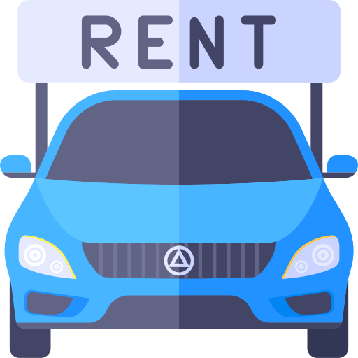
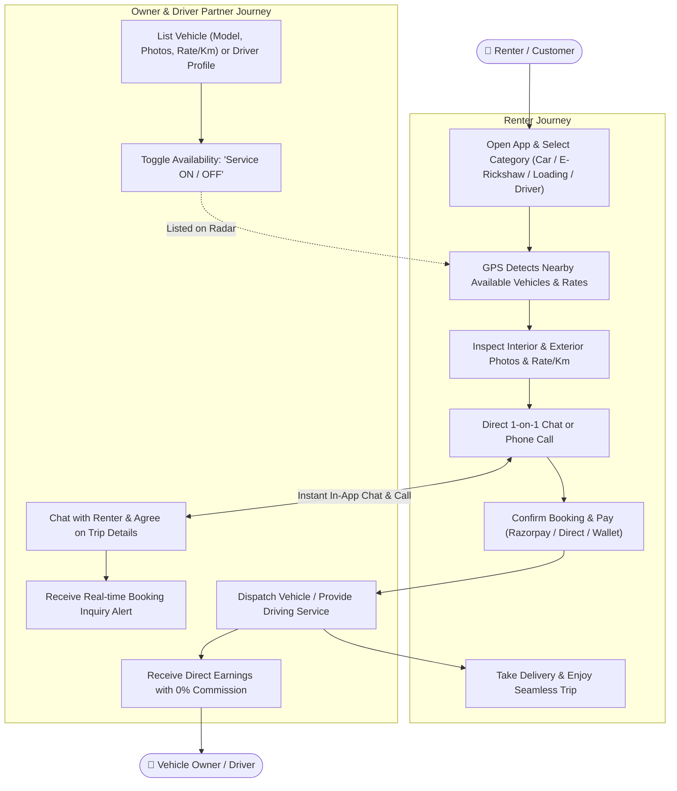

<div align="center">

  

  # **GaadiSaathi**
  ### *Your Trusted Mobility & Vehicle Rental Companion*

  **On-Demand Vehicle Rentals, Commercial Logistics & Professional Driver Hiring Platform.**

  <p align="center">
    <a href="https://play.google.com/store/apps/details?id=com.gaadisaathi.rent.apps">
      
    </a>
    <a href="https://github.com/SurajChaurasia84/GaadiSaathi/stargazers">
      
    </a>
    <a href="https://github.com/SurajChaurasia84/GaadiSaathi/network/members">
      
    </a>
  </p>

  <p align="center">
    
    
    
    
    
  </p>

  <a href="https://play.google.com/store/apps/details?id=com.gaadisaathi.rent.apps">
    
  </a>

</div>

---

## 📌 Table of Contents

- [What is RentWheels (GaadiSaathi)?](#-what-is-rentwheels-gaadisaathi)
- [Tech Stack Used](#-tech-stack-used)
- [Vehicle & Mobility Services Offered](#-vehicle--mobility-services-offered)
- [How RentWheels Works (Complete App Workflow)](#-how-rentwheels-works-complete-app-workflow)
  - [1. Renter / Customer Workflow](#1-renter--customer-workflow)
  - [2. Vehicle Owner & Driver Partner Workflow](#2-vehicle-owner--driver-partner-workflow)
  - [3. End-to-End Visual Workflow](#3-end-to-end-visual-workflow)
- [Key Features](#-key-features)
- [Download & Links](#-download--links)

---

## 💡 What is RentWheels (GaadiSaathi)?

**RentWheels (GaadiSaathi)** is an all-in-one vehicle mobility and automotive rental marketplace. It connects individuals and businesses directly with nearby vehicle owners, commercial transport operators, professional drivers, and auto workshops—with **zero broker commissions**.

Whether you need a car for a family vacation, an eco-friendly E-Rickshaw for local transits, a mini-truck for shifting goods, or an on-demand verified driver for outstation trips, RentWheels gets you rolling in minutes.

### Core Value Highlights:
- 🚫 **Zero Brokerage / Direct Connection:** Renters connect directly with vehicle owners and drivers via in-app chat or phone calls.
- 📍 **Proximity-Based Discovery:** Instantly discovers vehicles and drivers closest to your GPS coordinates.
- 📸 **Transparent Listings:** Complete visibility with interior/exterior photos, per-km rates, vehicle specs, and live availability.
- 👨‍✈️ **On-Demand Driver Hiring:** Book experienced, vetted drivers for personal cars, commercial runs, or long-distance journeys.
- 🛠️ **Automotive Ecosystem:** Quick access to nearby garages, authorized service centers, and auto spare parts shops.

---

## 💻 Tech Stack Used

| Component | Technology | Role in RentWheels |
| :--- | :--- | :--- |
| **Mobile Client** | **Flutter & Dart** | Cross-platform Material 3 responsive UI with dynamic theme switching and smooth navigation. |
| **State Management** | **Provider** (`AppState`) | Centralized state engine managing active vehicle feeds, real-time chats, user profiles, and wallet balances. |
| **Database & Auth** | **Firebase Auth & Cloud Firestore** | Secure Google & phone login, real-time database syncing vehicle listings, driver directories, and instant messaging. |
| **Payments** | **Razorpay Flutter SDK** | In-app secure gateway for booking security deposits, premium listings, and wallet top-ups. |
| **Geolocation** | **Geolocator & Geocoding** | Detects live GPS position to compute exact distance (km) to nearby vehicles, drivers, and shops. |
| **Notifications** | **Firebase Cloud Messaging & Local Notifications** | Instant alerts for incoming booking inquiries and real-time chat messages. |
| **Deep Linking** | **App Links** | Smooth deep-linking for direct vehicle sharing and referral reward invite links. |
| **Monetization** | **Google Mobile Ads** | Integrated non-intrusive banner and native ad monetization. |

---

## 🚗 Vehicle & Mobility Services Offered

<table>
  <tr>
    <td align="center" width="25%">
      <b>🚗 Cars</b><br /><br />
      <small>Sedans, Hatchbacks & SUVs for local trips, weekend getaways, and outstation family travel.</small>
    </td>
    <td align="center" width="25%">
      <b>🛺 E-Rickshaws</b><br /><br />
      <small>Eco-friendly, budget-friendly local city commutes and daily transit point connections.</small>
    </td>
    <td align="center" width="25%">
      <b>🚚 Loading Vehicles</b><br /><br />
      <small>Commercial mini-trucks, pickups, and cargo carriers for goods transport & house shifting.</small>
    </td>
    <td align="center" width="25%">
      <b>👨‍✈️ Driver Hiring</b><br /><br />
      <small>Hire skilled, verified personal or commercial drivers for daily, hourly, or outstation trips.</small>
    </td>
  </tr>
</table>

---

## 🔄 How RentWheels Works (Complete App Workflow)

RentWheels offers a smooth dual-sided journey that connects people who need mobility with owners who have vehicles.

### 1. Renter / Customer Workflow

```
[1. Select Category] ──► [2. Discover Nearby via GPS] ──► [3. Inspect Vehicle & Rate]
                                                                     │
                                                                     ▼
[6. Trip Complete] ◄──── [5. Confirm & Direct Booking] ◄─── [4. In-App Chat or Call]
```

1. **Choose Category:**
   - Launch app and select from **Cars**, **E-Rickshaws**, **Loading Vehicles**, **Drivers**, or **Auto Shops**.
2. **Find Nearby Options (GPS Radar):**
   - The app detects your current location and displays available vehicles and drivers sorted by proximity (distance in km).
3. **Inspect Vehicle Details:**
   - Review transparent details: high-resolution inside & outside photos, per-km rates, fuel type, owner profile, and live availability status (`Service ON/OFF`).
4. **Connect Directly (Chat / Call):**
   - Initiate a secure real-time 1-on-1 chat or tap to call the vehicle owner/driver directly to agree on timing and pickup points.
5. **Confirm Booking & Payment:**
   - Confirm rental duration, pay securely via Razorpay or direct arrangement, and redeem wallet bonus coins.
6. **Ride & Review:**
   - Enjoy your self-drive trip, cargo transit, or driven ride. Rate your experience upon completion.

---

### 2. Vehicle Owner & Driver Partner Workflow

```
[1. List Vehicle / Driver] ──► [2. Toggle Service ON] ──► [3. Receive Inquiries]
                                                                     │
                                                                     ▼
[6. Referral & Earnings] ◄──── [5. Complete Service] ◄──── [4. Chat & Finalize]
```

1. **Register & Create Listing:**
   - Add your vehicle in minutes: upload interior and exterior photos, vehicle type, model name, per-km rate, and location.
   - Drivers can register with their driving experience, license details, and expected daily/hourly rates.
2. **One-Tap Availability Toggle:**
   - Switch your listing `Service ON` when ready to accept bookings, or `Service OFF` when occupied or offline.
3. **Instant Inquiry Alerts:**
   - Receive real-time push notifications whenever a renter inquires about your vehicle or driver service.
4. **Direct Negotiation & Coordination:**
   - Chat directly through the in-app Inbox to finalize destination details and schedules with zero middleman commissions.
5. **Fulfill & Earn:**
   - Provide the vehicle or driving service and receive full agreed payment directly.
6. **Wallet & Referrals:**
   - Earn referral bonus coins by sharing your invite link and track your wallet balances directly in the app.

---

### 3. End-to-End Visual Workflow



---

## ✨ Key Features

- 🚘 **Diverse Mobility Fleet:** Support for private passenger cars, local eco E-Rickshaws, and commercial loading trucks.
- 👨‍✈️ **Vetted Driver Network:** Find skilled drivers on-demand for daily commutes or long journeys.
- 🗺️ **Live Proximity Engine:** Auto-sorts available listings by real-time distance in kilometers.
- 💬 **Zero-Commission In-App Chat:** Safe, direct communication between renters and owners without middleman fees.
- 💳 **Secure Digital Payments:** Razorpay integration for effortless online transactions and wallet management.
- 🎁 **Referral & Rewards System:** Share referral links with friends to earn bonus wallet coins on successful sign-ups.
- 🏪 **Auto Directory:** Integrated directory to locate nearby garages, vehicle maintenance centers, and spare part shops.

---

## 📲 Download & Links

- **Google Play Store:** [Download RentWheels (GaadiSaathi)](https://play.google.com/store/apps/details?id=com.gaadisaathi.rent.apps)
- **GitHub Repository:** [SurajChaurasia84/GaadiSaathi](https://github.com/SurajChaurasia84/GaadiSaathi)

<div align="center">
  <sub>Built with ❤️ for drivers, vehicle owners, and travelers.</sub>
</div>
